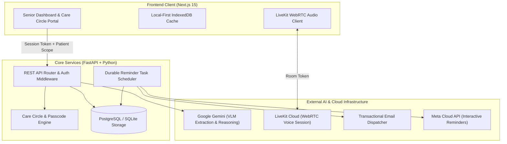

# CareSetu — Intelligent Elderly Care & Family Coordination Platform

> Empowering seniors and family care circles with intelligent medication schedule management, real-time adherence tracking, shared patient profiles, and proactive multi-channel reminders.

---

## 📌 Problem Overview

Geriatric and chronic healthcare present severe coordination challenges:
1. **Polypharmacy & Cognitive Overload**: Seniors frequently juggle 5–10 daily medications prescribed across multiple specialists, leading to missed doses, duplicate intakes, or dangerous drug interactions.
2. **Caregiver Blindspots**: Family members and informal caregivers often have no reliable way to verify if morning or evening medications were taken, relying on stressful phone calls or physical pillbox checks.
3. **Communication Friction**: Complex hospital portals and difficult mobile interfaces alienate seniors who struggle with fine motor control, complex navigation, or small typography.

**CareSetu** (Care Bridge) bridges this gap by providing an accessible, patient-centered platform where seniors maintain full ownership of their health records while seamlessly inviting trusted family members into a synchronized **Care Circle**.

---

## ✨ Key Capabilities

### 1. 🛡️ Patient-Controlled Family Care Circles
- **Scoped Passcode Invitations**: Seniors generate short-lived, single-use 8-digit access passcodes to onboard family members or professional caregivers.
- **Granular Role-Based Permissions**:
  - **Patient Owner**: Full administrative control, profile sharing, and permission revocation.
  - **Care Manager**: Can log doses, update medication schedules, and reschedule appointments on behalf of the patient.
  - **Care Viewer**: Read-only access to medication schedules, adherence history, and appointment logs.
- **Instant Revocation & Session Isolation**: Removing a caregiver immediately terminates active tokens and purges cached patient telemetry.

### 2. 💊 Medication Schedule & Adherence Telemetry
- **Dual Intake (OCR + Manual Entry)**: Digitize physical prescription slips via multi-agent Vision-Language models (Google Gemini) or input medication regimens manually.
- **Salt-Level Interaction Checks**: Real-time cross-referencing of active pharmaceutical ingredients across multi-doctor prescriptions to flag contraindications.
- **Actor-Attributed Adherence**: Records not only *when* a dose was logged, but *who* reported it (patient self-log vs. caregiver confirmation).
- **Timezone-Aware Schedule Engine**: Prevents duplicate reminders or false "missed" alerts across daylight savings and travel timezones.

### 3. 📬 Proactive Multi-Channel Reminders
- **Durable Email Notification Queue**: Mandatory transactional email alerts for:
  - Upcoming medication doses (with 1-click authenticated action deep links).
  - Overdue / unconfirmed medication warnings sent to the Care Circle.
  - Clinical appointment notifications and 24-hour reminder bulletins.
- **Interactive Messaging & Voice Fallbacks**: WhatsApp checklist templates and outbound telephony calls for non-digital seniors.

### 4. 🎙️ Conversational Voice Companion (LiveKit + Gemini)
- Real-time, ultra-low latency WebRTC voice agent designed specifically for seniors.
- Supports bilingual English and Hindi/Hinglish conversations with natural speech pause detection and interruptibility.
- Allows seniors to simply ask: *"Did I take my blood pressure medicine today?"* or *"When is my checkup with Dr. Sharma?"*

### 5. ♿ Senior-First Accessibility (WCAG 2.2 AA Aligned)
- High-contrast visual tokens (`#172B4D` on `#F8F5EE`), large touch targets (minimum 44×44px), 200% zoom reflow, and full keyboard navigation.
- Native `prefers-reduced-motion` compliance across all interface transitions.

---

## 🏛️ System Architecture



---

## 📂 Repository Structure

```
CareSetu/
├── .github/workflows/         # Continuous integration pipelines
├── agent/                     # LiveKit real-time voice agent worker
│   ├── chat.py                # Text companion chatbot service
│   ├── config.py              # Environment configuration & models
│   ├── voice.py               # LiveKit WebRTC agent with audio pipeline
│   └── prompt.py              # Clinical boundaries & senior companion prompt
├── backend/                   # FastAPI backend application
│   ├── alembic/               # Database migration versions
│   ├── app/
│   │   ├── auth.py            # Passcode generation, validation & JWT sessions
│   │   ├── caregiver.py       # Care Circle link management & member permissions
│   │   ├── conditions.py      # Chronic condition classification
│   │   ├── dosage.py          # Schedule parser & dosage notation normalizer
│   │   ├── extraction.py      # Gemini Vision multi-agent extraction pipeline
│   │   ├── interactions.py    # Multi-drug conflict & contraindication checker
│   │   ├── scheduler.py       # Durable task queue for multi-channel reminders
│   │   └── whatsapp.py        # Meta Cloud API message templates & webhooks
│   ├── data/                  # Reference medical catalogues & clinical schemas
│   └── tests/                 # Comprehensive unit & integration test suites
├── docs/                      # Engineering blueprints and implementation plans
│   └── plans/                 # Phased milestones and security checklists
└── frontend/                  # Next.js 15 modern application
    ├── app/                   # App Router pages (Dashboard, Scan, History)
    ├── components/            # Accessible UI components (Caregiver, Voice, etc.)
    ├── contexts/              # Multilingual LanguageContext (English & Hindi)
    └── lib/                   # API client, IndexedDB storage, and resource cache
```

---

## 🚀 Quickstart & Local Setup

### Prerequisites
- **Node.js** >= 18.18.0
- **Python** >= 3.10
- **npm** or **pnpm**

---

### 1. Backend Setup

```bash
cd backend
python -m venv .venv
source .venv/bin/activate  # On Windows: .venv\Scripts\activate

pip install -r requirements.txt
cp .env.example .env

# Run database migrations
alembic upgrade head

# Start FastAPI development server
uvicorn app.main:app --host 0.0.0.0 --port 8000 --reload
```

---

### 2. Frontend Setup

```bash
cd frontend
npm install

# Start Next.js development server
npm run dev
```

Visit `http://localhost:3000` in your browser.

---

### 3. Voice Companion Setup (Optional)

```bash
cd agent
python -m venv .venv
source .venv/bin/activate  # On Windows: .venv\Scripts\activate

pip install -r requirements.txt

# Start voice agent worker
python voice.py dev
```

---

## 🔒 Security & Privacy Guarantees

- **Zero-Knowledge Passcode Architecture**: Access passcodes are hashed with salted digests at rest and invalidated immediately upon single use or after 10 minutes.
- **Fail-Closed Security**: In the absence of a verified caregiver relationship, all access requests default to HTTP 403 Forbidden.
- **Ephemeral Medical Text**: Extracted prescription documents are processed strictly in-memory during inference without storing raw scans on public endpoints.
- **Audit Trails**: All medication logs, schedule modifications, and caregiver invitations generate immutable audit records.

---

## 📄 License & Attribution

Licensed under the [MIT License](LICENSE). Built for accessible elderly care and healthcare interoperability.

