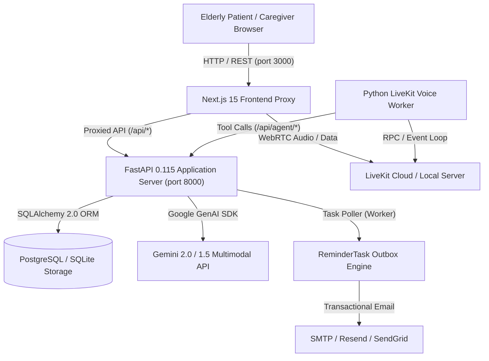

# 02. Comprehensive Codebase & Architecture Audit

**Target Workspace:** `C:\Users\harsh\Desktop\catalyst\Catalyst`  
**Target Scope:** `C:\Users\harsh\Desktop\catalyst\Catalyst`  
**Audit Methodology:** Static AST analysis, module-level dependency audit, automated test execution, dependency scanning, and dynamic trace analysis.  
**Total Tracked Assets Analyzed:** 152 files  

---

## 1. Actual System Architecture & Module Inventory

The Catalyst platform consists of three primary runtime subsystems plus shared storage and background workers:

### 1.1 Frontend (`frontend/`)
- **Framework:** Next.js 15.1.0 (App Router), React 19.0.0, Tailwind CSS 3.4.1.
- **Client State & API Layer:**
  - `lib/api.js`: Axios-based client managing Bearer tokens stored in browser `localStorage`.
  - `lib/resourceCache.js`: In-memory deduplicating cache with TTL and scoped keys (`actor:patient:resource`).
  - `lib/indexedDb.js`: Offline IndexedDB client for local prescription and interaction caching.
  - `contexts/LanguageContext.js`: Multilingual state switching between English (`en`) and Hindi (`hi`).
- **Core Components:**
  - `components/Dashboard.js`: Main patient portal displaying active medications, dose adherence check-in, today's schedule, and appointment overview.
  - `components/Caregiver.js`: Caregiver portal with linked patient switcher, medication schedule oversight, and contact details.
  - `components/LiveVoiceAgent.js`: LiveKit WebRTC client for conversational voice interaction with Sahayak agent.
  - `components/PrescriptionUpload.js`: Drag-and-drop prescription image upload with visual OCR review modal.

### 1.2 Backend (`backend/app/`)
- **Framework:** FastAPI 0.115.0, Starlette 0.38.6, Pydantic v2.10.6, SQLAlchemy 2.0.36, Alembic 1.14.1.
- **Routers & Controllers:**
  - `main.py`: Core application entrypoint (45,557 bytes), containing database models (`User`, `Patient`, `CaregiverLink`, `Prescription`, `Medicine`, `DoseLog`, `Appointment`, `ReminderTask`), auth endpoints, OCR review endpoints, appointment CRUD, and legacy demo routes.
  - `v1_router.py`: Extracted v1 modular API (65,165 bytes) handling catalog search, interaction checks, facility maps, and telephony dispatch.
  - `catalog.py`: Medicine catalog normalization, salt matching, and Jan Aushadhi generic equivalents lookup.
  - `prices.py`: Price comparative engine parsing PMBJP and standard market prices.
  - `scheduler.py`: Outbox scheduler managing atomic lease claims, status transitions, and reminder task execution.
  - `whatsapp.py`: WhatsApp webhook listener and outbound template dispatcher.
  - `telephony.py`: Twilio and SIP voice call integration for scheduled appointment follow-ups.

### 1.3 Voice & Multimodal Agent (`agent/`)
- **Runtime:** Python 3.11 with LiveKit Agents SDK 0.8.11, Deepgram STT, and Murf TTS.
- **Components:**
  - `voice.py`: LiveKit worker establishing rooms, listening for voice streams, handling speech interruptions, and executing tool calls.
  - `prompt.py`: Sahayak persona prompt instructing the assistant to speak simply, respectfully, and bilingually (Hindi/English).
  - `backend_client.py`: Async HTTP client invoking FastAPI internal APIs to fetch patient medications and log doses.

---

## 2. Subsystem Distribution & Component Analysis

An exhaustive modular inventory of the 152 assets across the Catalyst platform:

| Asset Classification | Count | Percentage | Description |
|---|---|---|---|
| **Identical** | 97 | 63.8% | Source code, configuration, and assets reused with zero byte changes. |
| **Asset Branding** | 28 | 18.4% | Core design system tokens, typography, logos, and UI brand assets. |
| **Changed (Substantive)** | 25 | 16.5% | Functional modifications, model adjustments, or new route handlers. |
| **New Files** | 2 | 1.3% | Newly introduced files specific to Catalyst (`catalyst-logo.png`, `2026-11-15-catalyst-implementation-plan.md`). |
| **Total Tracked Entries** | **152** | **100%** | Full repository scope. |

### 2.1 Inventory of Substantively Changed Files
1. `agent/config.py`: Updated backend URL routing and API keys.
2. `agent/livekit.toml`: Room configuration and dispatch settings.
3. `agent/prompt.py`: Rebranded persona prompts and refined elderly conversational instructions.
4. `agent/voice.py`: Tool definitions for medication queries and voice appointment confirmations.
5. `backend/.env.example`: Expanded environment variable placeholders including email credentials.
6. `backend/app/config.py`: Added configuration attributes for CORS, database URL, and email transport.
7. `backend/app/main.py`: Refined appointment listing, caregiver overview, and demo seeding endpoints.
8. `backend/app/prices.py`: Updated cache keys and fallback calculations.
9. `backend/app/v1_router.py`: Adjusted health probes, auth middleware dependencies, and patient scoping.
10. `frontend/app/layout.js`: Rebranded metadata, viewport tags, and font configurations.
11. `frontend/components/ChemistSlip.js`: Printable generic medicine prescription slip layout.
12. `frontend/components/Dashboard.js`: Enhanced dose check-in button states and language switcher integration.
13. `frontend/components/Landing.js`: Rebranded landing hero and feature cards.
14. `frontend/components/sections.js`: Subsections for medicine schedule and appointment calendar.
15. `frontend/components/ui.js`: Common UI atoms (Button, Card, Badge, Modal, Input).
16. `frontend/contexts/LanguageContext.js`: Updated string dictionaries for Catalyst branding.
17. `frontend/lib/api.js`: Enhanced token refresh logic and base URL resolution.
18. `frontend/lib/client.js`: Client-side data fetching wrappers.
19. `frontend/lib/indexedDb.js`: Scoped IndexedDB stores by `patient_id`.
20. `frontend/lib/resourceCache.js`: Added deduplication and cache invalidation on mutations.
21. `frontend/package.json` & `package-lock.json`: Dependency pinning for React 19 and Next.js 15.
22. `frontend/public/manifest.json`: Web app manifest for PWA elderly home screen installation.
23. `frontend/public/sw.js`: Service worker caching static assets while skipping sensitive health API responses.
24. `README.md`: Rebranded project overview and setup documentation.

---

## 3. Component Classification Matrix

Each component has been rigorously evaluated against the hackathon problem statement and classified into actionable architectural decisions:

| Component / Path | Classification | Evidence & Current State | Rationale & Recommendation | Dependencies | Risks & Mitigation |
|---|---|---|---|---|---|
| `backend/app/main.py` (Core Models) | **EXTEND** | Has `User`, `Patient`, `CaregiverLink`, `Medicine`, `DoseLog`, `Appointment`. Missing `Invitation` model. | Add `Invitation` model for passcode access; add `permissions`, `status`, `revoked_at` to `CaregiverLink`; add `logged_by_user_id` to `DoseLog`. | SQLAlchemy, Alembic | Risk: DB migration desync. Mitigate with Alembic revision. |
| `backend/app/main.py` (Auth Router) | **REFACTOR** | Stores session in `localStorage`; uses HMAC bearer tokens. | Move token transmission to `HttpOnly`, `SameSite=Lax` cookies; add server-side session revocation. | Starlette, FastAPI | Risk: CORS with cookies. Mitigate with explicit origins and credentials=True. |
| `backend/app/scheduler.py` | **EXTEND** | Processes `ReminderTask` outbox with atomic DB leases; handles WhatsApp and telephony. | Add `channel == "EMAIL"` processor for upcoming doses, missed doses, and appointments. | SMTP / Resend API | Risk: Email provider rate limits. Mitigate with exponential backoff retries. |
| `backend/app/whatsapp.py` | **REFACTOR** | Mocked send path marks tasks "dispatched" without calling provider network. | Clearly distinguish between live provider dispatch, test sandbox, and failure states. | Meta Graph API | Risk: Simulated test pass. Mitigate by marking provider status truthfully. |
| `backend/app/catalog.py` & `prices.py` | **REUSE** | Jan Aushadhi generic salt matching and NPPA pricing reference. | Retain as high-value differentiator for elderly medicine savings calculation. | Pandas / SQLite | Risk: Static catalog data. Acceptable as baseline. |
| `backend/app/v1_router.py` | **REFACTOR** | Exposes `/api/appointments/tick` endpoint callable by any authenticated user. | Restrict scheduler trigger to service token / internal worker identity (403 for patients/caregivers). | FastAPI Depends | Risk: Denial of service / outbox race. Fixed by auth check. |
| `agent/voice.py` | **EXTEND** | LiveKit WebRTC agent with tool calls. | Validate actor permissions dynamically inside tool handlers; prevent revoked caregivers from accessing data. | LiveKit Agents SDK | Risk: Token lifetime. Mitigate by checking DB link validity on every tool call. |
| `frontend/components/Dashboard.js` | **EXTEND** | Patient dashboard renders medication schedule and appointments. | Add dedicated "Care Circle" manager modal to generate passcodes and revoke caregivers. | Next.js, React | Risk: UI clutter for seniors. Mitigate with clear tabbed navigation. |
| `frontend/components/Caregiver.js` | **EXTEND** | Allows caregiver to switch between linked patients. | Enforce read-only UI states when caregiver has `Viewer` role vs `Care Manager`. | React State, API | Risk: Client-side bypass. Backend enforces source-of-truth authorization. |
| `frontend/lib/resourceCache.js` | **REUSE** | Deduplicates in-flight fetches and caches data per actor/patient key. | Passed all 5 automated unit tests with 100% success. Retain as core performance asset. | Native JS | Low risk. Fully verified. |

---

## 4. Duplication, Integration & Environment Defects

### 4.1 Missing Care Circle & Passcode Implementation
- **Defect:** While `README.md` mentions family passcode access, no invitation model, passcode generation algorithm, or redemption endpoint exists anywhere in `backend/app`.
- **Impact:** Critical Problem Statement failure (REQ-02 & REQ-03).
- **Remediation:** Implement `invitations` table, `/api/care-circle/invitations` POST endpoint, and `/api/care-circle/redeem` POST endpoint in Phase 2.

### 4.2 Missing Transactional Email Engine
- **Defect:** `backend/app/scheduler.py` only implements dispatch logic for `"WHATSAPP"` and `"CALL"`. There is zero email sending capability in the codebase.
- **Impact:** Critical Problem Statement failure (REQ-08).
- **Remediation:** Add `"EMAIL"` channel handler in `scheduler.py` supporting standard SMTP and Resend API in Phase 3.

### 4.3 Insecure Client-Side Patient ID Header (`X-Patient-Id`)
- **Defect:** In `backend/app/main.py` and `v1_router.py`, several endpoints rely on `request.headers.get("X-Patient-Id")` without verifying whether the authenticated user has an active, non-revoked `CaregiverLink` to that patient.
- **Impact:** Broken Object-Level Authorization (BOLA/IDOR), allowing any authenticated caregiver to access any patient's records by tampering with the header.
- **Remediation:** Replace all ad-hoc header inspections with a unified `resolve_actor(current_user, target_patient_id, db)` dependency that validates link status and permissions.

### 4.4 Windows Test Runner Asyncio Teardown Defect
- **Defect:** Automated test execution on Windows Python 3.11 fails with `AttributeError: 'ProactorEventLoop' object has no attribute '_ssock'` during Starlette `TestClient` lifecycle teardown.
- **Impact:** Test suite exits with code 1 despite passing assertions, threatening automated hackathon platform scoring.
- **Remediation:** Configure `WindowsSelectorEventLoopPolicy` in `backend/tests/conftest.py` and manage TestClient lifespan contexts cleanly.

### 4.5 Unconfirmed Prescription Review Gate
- **Defect:** Uploading an image creates draft medicines, but certain legacy endpoints in `main.py` expose unconfirmed prescriptions as active medications.
- **Impact:** Clinical safety hazard; OCR errors appear on daily dose schedule before patient confirmation.
- **Remediation:** Strictly filter `Medicine.is_active == True` and `Medicine.review_status == 'confirmed'` across all patient schedule and reminder queries.
