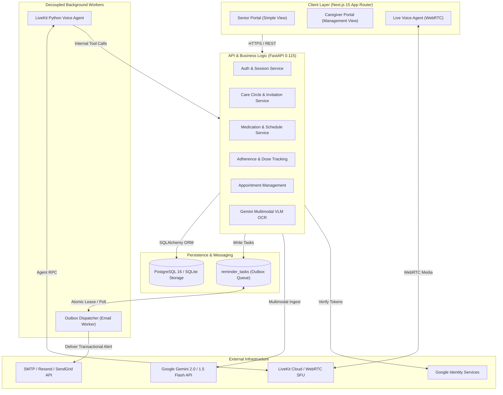
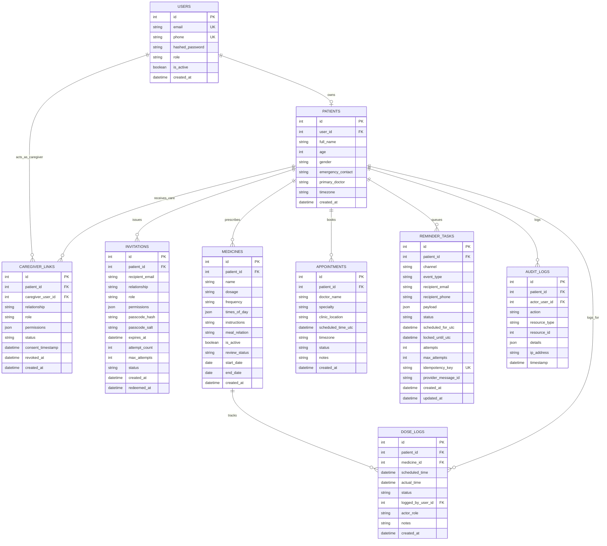
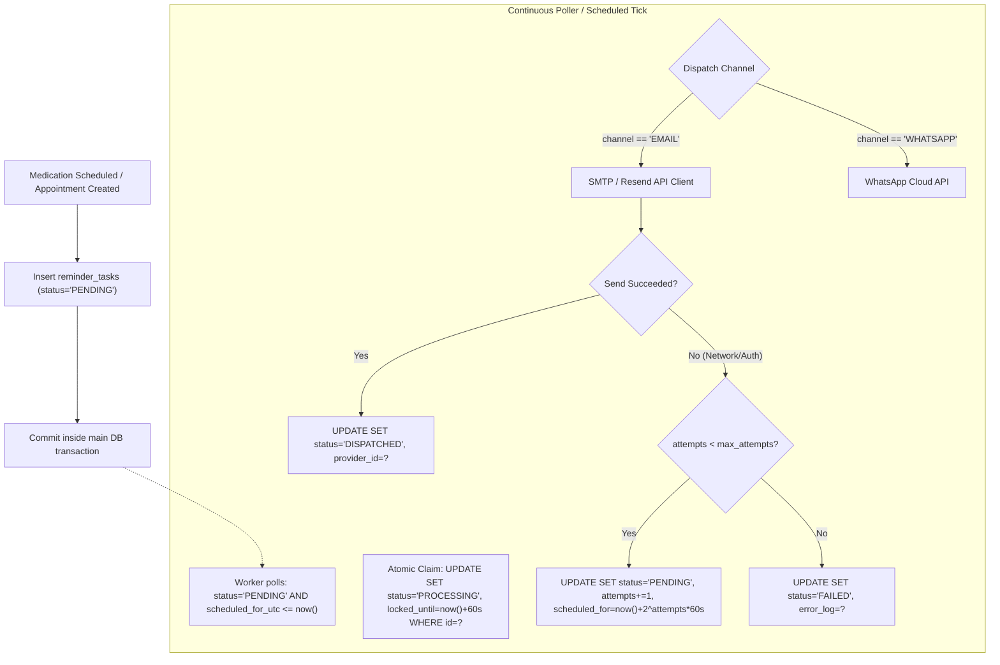

# 04. Target Architecture & Data Model Design

**Architecture Paradigm:** Clean Modular Monolith with Decoupled Background Workers  
**Core Technologies:** Next.js 15 (App Router), FastAPI 0.115, SQLAlchemy 2.0 / PostgreSQL, LiveKit Agents SDK, Gemini 2.0 / 1.5 Pro  
**Design Patterns:** Outbox Pattern for Durable Reminders, Repository / Service Layer, Strict RBAC Dependency Injection  
**Status:** Architecture Blueprint  

---

## 1. System Topology & Data Flow

The target Catalyst architecture achieves high reliability, low cognitive overhead for elderly patients, and secure family collaboration through clean service boundaries:



---

## 2. Relational Database Schema & Data Models

### 2.1 Entity Relationship Diagram (ERD)



---

## 3. Core API Specifications & Contracts

### 3.1 Care Circle & Passcode Invitations
- **POST `/api/care-circle/invitations`**
  - *Caller:* Authenticated Patient (Owner only).
  - *Request Body:*
    ```json
    {
      "recipient_email": "daughter@example.com",
      "relationship": "Daughter",
      "role": "CARE_MANAGER",
      "permissions": ["read", "write_meds", "write_adherence", "write_appointments"]
    }
    ```
  - *Response (201 Created):*
    ```json
    {
      "invitation_id": 42,
      "recipient_email": "daughter@example.com",
      "expires_at": "2026-11-15T12:00:00Z",
      "message": "Invitation created. Passcode dispatched via secure email."
    }
    ```
- **POST `/api/care-circle/redeem`**
  - *Caller:* Authenticated Caregiver User.
  - *Request Body:*
    ```json
    {
      "recipient_email": "daughter@example.com",
      "passcode": "84729103"
    }
    ```
  - *Response (200 OK):*
    ```json
    {
      "success": true,
      "patient_id": 101,
      "patient_name": "Ramesh Patel",
      "role": "CARE_MANAGER",
      "permissions": ["read", "write_meds", "write_adherence", "write_appointments"]
    }
    ```
- **POST `/api/care-circle/members/{link_id}/revoke`**
  - *Caller:* Authenticated Patient (Owner only).
  - *Response (200 OK):*
    ```json
    {
      "success": true,
      "link_id": 12,
      "status": "REVOKED",
      "revoked_at": "2026-11-15T11:50:00Z"
    }
    ```

### 3.2 Medication Schedule Management
- **GET `/api/medications`**
  - *Parameters:* `?patient_id=101` (Validated against caller permissions).
  - *Response (200 OK):* Array of active medications with dose time slots.
- **POST `/api/medications`**
  - *Caller:* Patient or Caregiver with `write_meds`.
  - *Request Body:*
    ```json
    {
      "name": "Metformin",
      "dosage": "500 mg",
      "frequency": "BID",
      "times_of_day": ["08:00", "20:00"],
      "meal_relation": "AFTER_MEAL",
      "instructions": "Take with full glass of water",
      "start_date": "2026-11-15",
      "end_date": null
    }
    ```
- **POST `/api/medications/{id}/adherence`**
  - *Caller:* Patient or Caregiver with `write_adherence`.
  - *Request Body:*
    ```json
    {
      "scheduled_time": "2026-11-15T08:00:00Z",
      "status": "TAKEN",
      "notes": "Taken on time with breakfast"
    }
    ```
  - *Response (200 OK):* Returns created `DoseLog` with `logged_by_user_id` and updated daily adherence score.

---

## 4. Durable Reminder Outbox & Background Processing

To guarantee zero lost email notifications, Catalyst implements the **Transactional Outbox Pattern**:



### 4.1 Worker Guarantees
1. **Idempotency:** Every task carries a deterministic `idempotency_key` (e.g., `dose:{patient_id}:{medicine_id}:{scheduled_slot_iso}`). Duplicate scheduling attempts are ignored by a database unique constraint.
2. **Crash Resilience:** If a worker crashes mid-delivery, `locked_until_utc` expires after 60 seconds, allowing another worker process to safely reclaim and dispatch the task.
3. **Auditability:** Every dispatch records the provider message ID and delivery timestamp in `reminder_tasks`.
