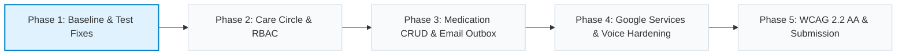

# 10. Master Execution Index & Coding Agent Guide

**Project:** Catalyst — Intelligent Elderly Care & Family Coordination Platform  
**Challenge:** Elderly Care & Medication Management Platform (PromptWars x Catalyst | Build with AI)  
**Execution Mode:** Strict Phase-Gated Development Protocol  
**Master Timeline:** Final Submission by 15:30 Asia/Kolkata  
**Status:** Approved Master Blueprint & Operational Guide  

---

## 1. Quick Navigation & Document Directory

All planning documents are located under `docs/planning/`:

| Document | Purpose & Core Contents | Link |
|---|---|---|
| `01_HACKATHON_REQUIREMENTS.md` | Verified challenge rules, rubric, evaluation criteria, and requirement traceability matrix. | [01_HACKATHON_REQUIREMENTS.md](file:///C:/Users/harsh/Desktop/catalyst/Catalyst/docs/planning/01_HACKATHON_REQUIREMENTS.md) |
| `02_CODEBASE_AUDIT.md` | Architecture, module inventory, 152-asset component analysis, component classification. | [02_CODEBASE_AUDIT.md](file:///C:/Users/harsh/Desktop/catalyst/Catalyst/docs/planning/02_CODEBASE_AUDIT.md) |
| `03_SECURITY_AUTHORIZATION.md` | Threat model, zero-trust RBAC matrix, passcode cryptographic specification, BOLA/IDOR fixes. | [03_SECURITY_AUTHORIZATION.md](file:///C:/Users/harsh/Desktop/catalyst/Catalyst/docs/planning/03_SECURITY_AUTHORIZATION.md) |
| `04_ARCHITECTURE_DESIGN.md` | Target system topology, relational ERD schemas, OpenAPI specifications, outbox architecture. | [04_ARCHITECTURE_DESIGN.md](file:///C:/Users/harsh/Desktop/catalyst/Catalyst/docs/planning/04_ARCHITECTURE_DESIGN.md) |
| `05_GAP_ANALYSIS.md` | Feature-by-feature delta matrix, severity rankings (P0/P1/P2), and remediation paths. | [05_GAP_ANALYSIS.md](file:///C:/Users/harsh/Desktop/catalyst/Catalyst/docs/planning/05_GAP_ANALYSIS.md) |
| `06_PHASED_IMPLEMENTATION.md` | 5-phase dependency-aware engineering plan with exact file changes and acceptance tests. | [06_PHASED_IMPLEMENTATION.md](file:///C:/Users/harsh/Desktop/catalyst/Catalyst/docs/planning/06_PHASED_IMPLEMENTATION.md) |
| `07_TESTING_STRATEGY.md` | Unit, integration, E2E, accessibility, Windows asyncio fix, and performance benchmarks. | [07_TESTING_STRATEGY.md](file:///C:/Users/harsh/Desktop/catalyst/Catalyst/docs/planning/07_TESTING_STRATEGY.md) |
| `08_INNOVATION_STRATEGY.md` | The 4 core differentiators: Escalation matrix, Dual-Perspective UI, Audio Explainer, Visit Brief. | [08_INNOVATION_STRATEGY.md](file:///C:/Users/harsh/Desktop/catalyst/Catalyst/docs/planning/08_INNOVATION_STRATEGY.md) |
| `09_DEPLOYMENT_SUBMISSION.md` | Cloud Run / Docker Compose deployment, environment variables, pre-flight audit checklist, demo script. | [09_DEPLOYMENT_SUBMISSION.md](file:///C:/Users/harsh/Desktop/catalyst/Catalyst/docs/planning/09_DEPLOYMENT_SUBMISSION.md) |
| `10_MASTER_EXECUTION_INDEX.md` | This master index, execution dashboard, and phase-gated handoff protocol. | [10_MASTER_EXECUTION_INDEX.md](file:///C:/Users/harsh/Desktop/catalyst/Catalyst/docs/planning/10_MASTER_EXECUTION_INDEX.md) |

---

## 2. Phase-Gated Execution Protocol

Any coding agent operating on this project must strictly observe the following protocol:

1. **One Phase at a Time:** Implement **only** the currently authorized phase. Never combine phases or start future phases in advance.
2. **Mandatory Post-Phase Verification:**
   - Run `python backend/run_isolated_tests.py`
   - Run `node frontend/scripts/test-resource-cache.mjs`
   - Run `node frontend/scripts/test-history-basket.mjs`
   - Verify zero regressions in prior tests.
3. **Report & Stop:**
   - State files changed.
   - Present actual terminal output and pass/fail counts.
   - Confirm acceptance criteria satisfaction.
   - **STOP AND WAIT FOR USER APPROVAL** before touching files in the next phase.
4. **No Unapproved Deletions:** Never delete legacy files, reset production databases, or purge directories without explicit user authorization.

---

## 3. Master Phase Dashboard



| Phase | Core Objective | Key Deliverables | Verification Command | Approval Status |
|---|---|---|---|---|
| **Phase 1** | Baseline Environment & Test Runner Fix | `backend/tests/conftest.py`, Windows asyncio fix, `run_isolated_tests.py` green | `python backend/run_isolated_tests.py` | **READY FOR AUTHORIZATION** |
| **Phase 2** | Passcode Care Circle & RBAC | `invitations` table, 8-digit CSPRNG passcode, Care Circle UI, BOLA elimination | `pytest backend/tests/test_care_circle.py` | Pending Phase 1 completion |
| **Phase 3** | Medication CRUD & Email Outbox | Direct Med CRUD, actor attribution in `DoseLog`, durable email reminder outbox | `pytest backend/tests/test_email_reminders.py` | Pending Phase 2 completion |
| **Phase 4** | Google Services & Voice Hardening | Gemini 2.0 / 1.5 VLM prescription parsing, Google OAuth, LiveKit tool RBAC | `pytest backend/tests/test_google_services.py` | Pending Phase 3 completion |
| **Phase 5** | Elderly Accessibility & Submission | WCAG 2.2 Senior Mode UI, audio dose reader, Cloud Run deploy, final smoke test | `node frontend/scripts/test-e2e-journey.mjs` | Pending Phase 4 completion |

---

## 4. Quick CLI Command Reference

### Running Backend Tests
```powershell
# Run the complete isolated test suite
python backend/run_isolated_tests.py

# Run a specific test suite
pytest backend/tests/test_auth_registration.py -v
```

### Running Frontend Verification Tests
```powershell
# Change directory to frontend
cd frontend

# Verify dependency security
node scripts/test-dependencies.mjs

# Verify resource caching & actor isolation
node scripts/test-resource-cache.mjs

# Verify prescription basket calculation
node scripts/test-history-basket.mjs
```

### Starting Development Servers
```powershell
# Backend (FastAPI on port 8000)
cd backend
uvicorn app.main:app --reload --port 8000

# Frontend (Next.js on port 3000)
cd frontend
npm run dev

# LiveKit Voice Agent Worker
cd agent
python voice.py dev
```
